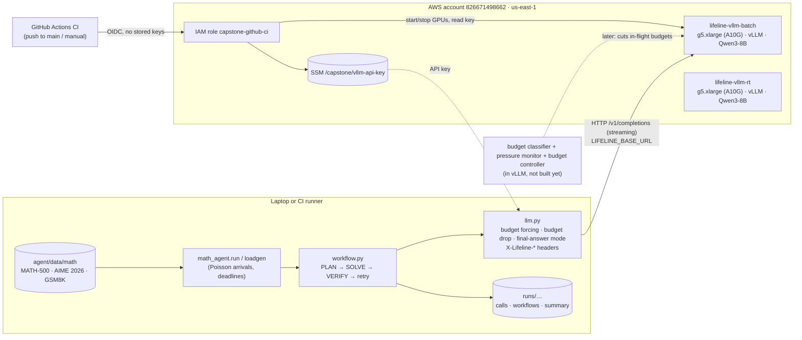

# Math agent

The workload for Thinking Brownout. It solves math problems as multi-step LLM
workflows. Every workflow has a verifiable answer, a deadline and a token cost, and
most of that cost is reasoning (thinking) tokens. Its traffic is what the budget
controller cuts under load, its accuracy shows what a cut costs, and its budget
levers are the ones the team's budget-drop experiments measured.

The earlier FinQA agent is archived in [`archive/finqa/`](archive/finqa/).

## System today



- The agent calls one OpenAI-compatible endpoint (`LIFELINE_BASE_URL`), today the
  `lifeline-vllm-batch` server; `lifeline-vllm-rt` is a second GPU for experiments.
  The budget drop and the cut notice are emulated client-side by the agent until the
  budget controller does them inside vLLM; the agent needs no change when it does.
- The vLLM API key lives in SSM. `infra/vllm-ec2/` reads it from there unless
  `secrets.env` sets it, and it works with any credentials for the account (a profile,
  `secrets.env`, or CI's role).
- CI assumes `capstone-github-ci` through GitHub's OIDC, so the repo stores no AWS keys.
  On every push to `main` it runs the unit and end-to-end tests, then starts the batch
  GPU, runs the whole suite again with the live test against real vLLM, and stops the GPU
  if it started it.

## Workflow

```
PLAN -> SOLVE -> VERIFY --(confident or out of rounds)--> ANSWER
          ^         |
          +---------+  rejected: double the thinking budget, tell SOLVE what was rejected
```

| Step | Kind | What it does |
|---|---|---|
| PLAN | LLM, no thinking | Lists the approach in at most 4 lines |
| SOLVE | LLM, thinking budget | Solves the problem; answer in `\boxed{}`. Optional mid-thinking budget drop and final-answer-only mode (below) |
| VERIFY | LLM, short thinking budget | Confidence in [0, 1] that the boxed answer is right; below `--conf` triggers another SOLVE round. The last round is not verified |

Scoring (`grading.py`) is ported from Matthew's budget-drop benchmark: the last
`\boxed{}` is compared to the gold answer after normalisation, then numerically, then
with math-verify if installed (`pip install -e .[math]`).

## Datasets

| `--dataset` | Source | Problems | Notes |
|---|---|---|---|
| `math500` (default) | HuggingFaceH4/MATH-500 | 262 at `--levels 4 5` (default) | Natural thinking median about 4k tokens on Qwen3-4B |
| `aime2026` | MathArena/aime_2026 | 30 | Held after Qwen3's release, so not memorised; natural thinking median about 12.7k tokens |
| `gsm8k` | GSM8K test | 1,319 | Short problems, a light traffic class |

The MATH **train** split is not available here on purpose: it is reserved for
building the budget-notice training data.

Data is downloaded to `agent/data/math/` on first use.

## Budget levers (from Matthew's budget-drop tests, 10-19)

| Flag | What it does | Matches his arm |
|---|---|---|
| (budget runs out) | Qwen's early-stop line + `</think>`, then the answer | `cut_now` |
| `--drop-at A --drop-to W` | After A thinking tokens, only W more are allowed, then the answer is forced | `silent_W` |
| `... --notice soft` | Same, with "Wait, I'm running out of time..." inserted at the drop | `warn_soft_W` |
| `... --notice count` | Same, with "I only have about W tokens of thinking left..." | `warn_count_W` |
| `--answer-mode final` | After `</think>` the answer is primed with "The final answer is \boxed{" and capped at 48 tokens, so no reasoning can hide in the answer | Test C |

The drop applies to every SOLVE call and is done client-side for now: the second
think request carries `X-Lifeline-Budget-Drop: A,W,notice`. Once the budget
controller cuts budgets inside vLLM under load (and injects `<budget_cut left=N>`),
it takes this over, and these flags become the way to replay a fixed cut.

## Request headers

The agent only knows one OpenAI-compatible `base_url` (`/v1/completions`, streaming).
Every request carries these headers, so the server side (budget classifier, budget
controller, metrics) can tell workflows, steps and phases apart:

| Header | Meaning |
|---|---|
| `X-Lifeline-Class` | `agentic` (interactive chat traffic will send `interactive`) |
| `X-Lifeline-Workflow` | workflow id, shared by all calls of one problem |
| `X-Lifeline-Step` | `plan`, `solve.<round>`, `verify.<round>` |
| `X-Lifeline-Phase` | `think` or `answer` (a reasoning call is two or three requests) |
| `X-Lifeline-Thinking-Budget` | thinking tokens allowed for this request |
| `X-Lifeline-Deadline` | workflow deadline, epoch ms |
| `X-Lifeline-Budget-Drop` | only on the think request after a drop: `at,to,notice` |
| `X-Lifeline-Tier` | optional thinking-tier hint; the server may echo the tier it predicted in the response header |

The header names and the `LIFELINE_*` environment variables keep their old prefix
so teammates' `secrets.env` files keep working.

The thinking budget is enforced by budget forcing (Qwen3 chat format): the think
phase stops at `</think>` or at the budget, then the answer phase is a second request
on the same prefix (cheap with prefix caching).

## Tests

`pytest -q` runs these, all without a GPU:
- `test_grading.py`: answer extraction and matching
- `test_workflow.py`: the state machine and budget levers, in process, against a fake transport
- `test_workload.py`: workload spec parsing, per-problem budgets, rate-profile arrivals (same seed, same arrivals; counts per segment), phase labels, per-phase and pressure summaries, and the profile and closed-loop loadgen modes against the stub
- `test_agent_e2e.py`: the real CLIs (`math_agent.run`, `math_agent.loadgen`), started as subprocesses and configured through the `LIFELINE_*` environment variables, talking over HTTP to a local server that speaks vLLM's API, streaming and API-key check (`tests/vllm_stub.py`). They check that each step feeds the next (the plan reaches SOLVE, SOLVE's answer reaches VERIFY, rejected answers reach the retry), that the thinking budget grows and is capped, the budget drop and final-answer mode, deadlines, a bad API key, and that the load generator runs workflows concurrently

`test_live.py` runs one GSM8K workflow against a real server. It is skipped unless
`MATH_AGENT_LIVE=1` is set together with `LIFELINE_BASE_URL` and `LIFELINE_API_KEY`
(for example after `up.sh`). CI's `aws` job sets them and runs it against the batch GPU
on every push to `main`.

## Running

```bash
cd agent
pip install -e .[test,math] && pytest -q

# two GPU boxes (rt, batch) running vLLM; see the top-level README for credentials
eval "$(../infra/vllm-ec2/up.sh | sed 's/^/export /')"   # LIFELINE_BASE_URL points at the batch GPU

python -m math_agent.run --index 0 -v                              # one problem, full trace
python -m math_agent.run --n 50 --out runs/solo                     # solo calibration
python -m math_agent.run --n 50 --drop-at 2048 --drop-to 512 --notice count --answer-mode final
python -m math_agent.loadgen --rate 0.05 --n 100 --solo-ref runs/solo/workflows.jsonl --only-ref

../infra/vllm-ec2/down.sh                                           # stop both GPU boxes
```

The servers run with an 8,192-token context (`MAX_MODEL_LEN` in
`infra/vllm-ec2/config.env`). The default budgets (4,096 doubling to 6,144) fit
that. AIME 2026 needs natural thinking of about 12.7k tokens (up to 40k), so raise
`MAX_MODEL_LEN` and `--budget` / `--max-budget` before running it.

Each run writes:
- `calls.jsonl`: one row per LLM call (tokens, TTFT, latency, budget, phases, whether a drop happened and whether the model closed `</think>` itself)
- `workflows.jsonl`: one row per problem (answer, correctness, deadline met, totals)
- `summary.json`

Load generator: open-loop Poisson arrivals at `--rate` workflows/s. Each workflow's
deadline is `arrival + slack * (that problem's solo latency)`, with slack drawn from
`--slack` (default `1.5,3,6`). Give exactly one of `--rate`, `--profile` or `--closed`:

| Flag | What it does |
|---|---|
| `--rate R --n N` | N workflows, Poisson at R workflows/s |
| `--profile 180:0.7,120:1.5,... --capacity C` | Segments of `duration_s:rate`, the rate in units of C; Poisson within each segment. Arrival times, problems and slacks are fixed by `--seed`. Workflows record `segment`, `phase` (`burst` when the rate is above 1, else `baseline`) and `offset_s`; the summary has `by_phase`, `by_segment`, `by_band` and `by_band_phase` |
| `--tail-s S` | Profile mode: cancel workflows still running S seconds after the profile ends. They count as wrong and late (`cancelled` in the summary) |
| `--closed K --warmup-s W --duration-s D` | Capacity: K workflows stay in flight; completions between W and W + D give `capacity_wf_s` and `capacity_think_tok_s` |
| `--workload SPEC` | `dataset[:levels][=weight],...`, e.g. `math500:1-5` or `gsm8k=0.5,math500:4-5=0.5`. Replaces `--dataset` / `--levels` |
| `--level-budgets` | Budget per problem instead of `--budget` / `--max-budget`: MATH levels 1-2 2048 (max 4096), 3 4096 (max 6144), 4-5 and AIME 6144 (max 6144), GSM8K 1024 (max 2048). The solo latency for deadlines is 150 s, 300 s, 450 s and 90 s for those bands |

```bash
python -m math_agent.loadgen --workload math500:1-5 --level-budgets --closed 32
python -m math_agent.loadgen --workload math500:1-5 --level-budgets --capacity 0.05 \
    --profile 180:0.7,120:1.5,300:0.7 --tail-s 600
```

## Layout

```
math_agent/
  datasets/      Example type; math.py loads MATH-500, AIME 2026, GSM8K
  grading.py     \boxed{} extraction and answer matching
  llm.py         completions client, headers, budget forcing, budget drop, final-answer mode
  prompts.py
  workflow.py    the state machine above
  run.py         sequential runs (trace / calibration)
  loadgen.py     load with deadlines: fixed rate, rate profile, or closed loop for capacity
  workload.py    workload specs, per-problem budgets, rate profiles
  metrics.py
tests/           grading; workflow and budget levers; workloads and profiles; end-to-end CLI runs against a local vLLM stub
archive/finqa/   the earlier FinQA agent and its 2026-10-16 results (reference only)
```
